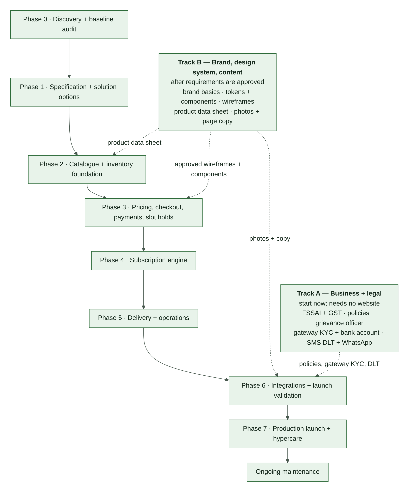

\pagebreak

# PART B — PRODUCT AND BUSINESS

# 2. Executive Summary

Greenbasket is a fresh-produce e-commerce business serving Chandigarh, Mohali, and Panchkula. The website is being built on WordPress and WooCommerce, with Blocksy as the theme, Elementor Free for page design, and Hostinger as the hosting provider. The domain and hosting have been purchased (**CONFIRMED**).

Greenbasket intends to launch four shopping experiences together:

1. Retail store
2. Farm Box builder
3. Wholesale store
4. Subscription service

All experiences must use one consistent commerce foundation: a shared product catalogue, shared inventory pool, customer identity, pricing engine, cart and checkout where compatible, order management, payment reconciliation, and delivery operations.

The system must support:

- retail products sold in predefined packs or pieces;
- fixed pack prices independent of actual packed weight;
- Farm Box baskets made from eligible products;
- public wholesale pricing with product-specific quantity tiers;
- fixed-price subscription plans with an eligible-product monetary allowance;
- weekly and monthly billing and delivery combinations;
- separate delivery orders for each delivery in a monthly-billed, weekly-delivered subscription;
- online payments, eligible COD, and bank transfer;
- a shared stock pool with reservation handling;
- customer-selected delivery slots with limited capacity;
- own delivery operations;
- support-reviewed refund requests;
- configurable business rules and auditable operational records.

**Primary architectural objective:** operate four shopping experiences through one reliable system without duplicating product identities, stock, customers, orders, or charges.

**Important constraint:** no plugin may be selected or installed until requirements, the current website, compatibility, and implementation alternatives have been reviewed.

# 3. The 15 Pillars and Build Order

An e-commerce platform rests on fifteen pillars. On WordPress and WooCommerce many of them are already provided by the platform; Greenbasket builds only what is specific to its business.

> **Frontend, backend and database on WordPress.** WooCommerce already provides a working backend (products, cart, checkout, orders, customers) and stores everything in the MySQL database that comes with the hosting plan. Blocksy and Elementor provide the frontend. Greenbasket builds only what WooCommerce does not have: the shared stock ledger and reservations, wholesale tiers, the Farm Box builder, subscriptions with allowances, delivery slots, payment reconciliation and the operations screens.

<!-- widths: 5,22,33,18,22 -->
| # | Pillar | What it covers | Where | When |
|---|---|---|---|---|
| 1 | Business and legal groundwork | Registrations, policies, gateway KYC, messaging registrations | §5 | Track A — start now |
| 2 | Requirements and features | What every experience must do | §4, §6, §8 | This document |
| 3 | System design and architecture | How the parts work together; states and workflows | §7, §10–§17 | Frozen in Phase 1 |
| 4 | Hosting, domain and environments | Server, SSL, staging, email, scheduled jobs, access | §21 | Phase 0 verifies; Phase 1 decides |
| 5 | Database | What is stored, how, and with which guarantees | §9 | Phase 1 designs; Phase 2 builds |
| 6 | Backend | WooCommerce plus the Greenbasket extension logic | §8, §10–§15 | Phases 2–5 |
| 7 | Payments | Methods, gateway, callbacks, reconciliation, refunds | §16 | Phase 1 selects; Phase 3 builds in sandbox; Phase 6 goes live |
| 8 | Security | Access control, data protection, WordPress hardening | §22 | Every phase |
| 9 | Brand and design system | How Greenbasket looks: tokens, components, imagery | §18 | Track B |
| 10 | Frontend and shopper experience | Pages, journeys, mobile, accessibility, speed | §19 | Track B wireframes; built in Phases 3–5 |
| 11 | Content and catalogue | Product data, photos, descriptions, page and policy text | §20 | Track B |
| 12 | Operations and customer support | Packing, delivery, queues, COD cash, support channels | §15, §24 | Phase 5 |
| 13 | Marketing, SEO and analytics | Being found, consent, measurement | §17, §25 | Phase 6 |
| 14 | Testing | Acceptance, concurrency, load, recovery, real-shopper tests | §26 | Every phase; full run in Phase 6 |
| 15 | Launch and ongoing maintenance | Go-live, hypercare, updates, renewals | §28 | Phase 7 onwards |

Build-order rules:

- **Track A starts immediately.** Registrations and gateway onboarding have the longest lead times, and the payment gateway will not activate without the policy pages and business documents.
- **Requirements and system design come before the database,** because the database is designed from them.
- **The engine (pillars 5–8) comes before the shop window (pillars 9–11),** because pages display what the engine does. Track B needs no code and can run in parallel once requirements are approved.
- **Security is not a step.** It starts at setup and never stops.

# 4. Confirmed Requirements

Everything in this section is **CONFIRMED** by the owner unless a row says otherwise.

## 4.1 Business and platform (BP)

<!-- widths: 10,90 -->
| ID | Requirement |
|---|---|
| BP-01 | Business: Greenbasket, fresh-produce e-commerce. |
| BP-02 | Service area: Chandigarh, Mohali, Panchkula. |
| BP-03 | Platform: WordPress + WooCommerce. Theme: Blocksy. Page builder: Elementor Free. Hosting: Hostinger. Domain and hosting already purchased. |
| BP-04 | Website first. |
| BP-05 | All four shopping experiences launch together. |
| BP-06 | Customer types: households and businesses. |
| BP-07 | Sourcing and procurement workflow: **NOT IN SCOPE** for now. |
| BP-08 | Delivery: Greenbasket's own delivery operation. |
| BP-09 | Custom development budget: not decided (OD-12). |
| BP-10 | Plugin budget: initially free-only; must be reconciled against reliability, gateway, subscription and operations requirements before implementation (OD-18). |
| BP-11 | Prefer configuration over custom code when the capability is reliable and compatible. |
| BP-12 | WooCommerce with a modular custom extension is permitted if required. |

## 4.2 Retail (RT)

<!-- widths: 10,90 -->
| ID | Requirement |
|---|---|
| RT-01 | Products are sold in predefined pack sizes or pieces, depending on the product. |
| RT-02 | The selected pack price is fixed. |
| RT-03 | Actual packed weight does not recalculate the customer price. |
| RT-04 | Stock deduction uses the nominal quantity of the selected selling unit. |
| RT-05 | Product-specific units are allowed. |

## 4.3 Farm Box (FB)

<!-- widths: 10,90 -->
| ID | Requirement |
|---|---|
| FB-01 | Customer selects eligible products and quantities. |
| FB-02 | Customer pays for the selected items. |
| FB-03 | No Farm Box minimum is required initially. |
| FB-04 | A basket can be saved and reused. |
| FB-05 | A saved basket is a template, not a stock reservation or price guarantee. |
| FB-06 | Products consume the same shared stock pool as other channels. |
| FB-07 | Farm Box items may be combined with compatible products in a shared cart and order. |

## 4.4 Wholesale (WS)

<!-- widths: 10,90 -->
| ID | Requirement |
|---|---|
| WS-01 | Public access is allowed; wholesale pricing is not restricted to approved business accounts by default. |
| WS-02 | Each product has its own quantity tiers. |
| WS-03 | The tier rate applies to every unit at the qualifying tier. |
| WS-04 | Quantities for the same product and same selling unit are combined across cart lines before tier calculation (scope: OD-26). |
| WS-05 | Minimum, maximum, and quantity increment rules are configurable per product. |
| WS-06 | Manual quotation for exceptions is supported as an operational process; its workflow is not yet specified (OD-14). |
| WS-07 | Retail and wholesale lines may appear in one cart. |
| WS-08 | Tier boundaries and rates are not decided and must remain **CONFIGURABLE** (OD-01). |

## 4.5 Subscriptions (SB)

<!-- widths: 10,90 -->
| ID | Requirement |
|---|---|
| SB-01 | Billing cadence: weekly or monthly. |
| SB-02 | Delivery cadence: weekly or monthly. |
| SB-03 | Supported combinations: weekly billing + weekly delivery; monthly billing + monthly delivery; monthly billing + weekly deliveries. |
| SB-04 | Monthly billing with weekly delivery creates a separate order for each delivery, linked to the same billing period. |
| SB-05 | Plan price is fixed per subscription period. |
| SB-06 | Plan allowance is a monetary allowance for eligible products. |
| SB-07 | The product basket cannot exceed the allowance. |
| SB-08 | Delivery charges and applicable taxes are separate from the plan product allowance and price, as confirmed by the owner. |
| SB-09 | Customer can edit, skip, pause, and cancel a subscription. |
| SB-10 | If the basket-edit cutoff is missed, the last saved basket is used. |
| SB-11 | Customer chooses from eligible products. |
| SB-12 | A payment method is saved for automatic renewal only if the chosen gateway and applicable requirements support the intended flow. |
| SB-13 | Renewal failure: up to three retries over three days, then future deliveries pause. |
| SB-14 | Skipping a weekly delivery within a monthly subscription does not automatically reduce the monthly charge. |
| SB-15 | Basket and delivery snapshots are preserved for audit. |

## 4.6 Checkout and payments (CP)

<!-- widths: 10,90 -->
| ID | Requirement |
|---|---|
| CP-01 | Shared cart and checkout for compatible one-time purchases. |
| CP-02 | Guest checkout and account checkout are both desired. |
| CP-03 | One delivery address per order. |
| CP-04 | One customer account across shopping experiences. |
| CP-05 | Payment methods: online, COD for eligible orders, bank transfer. |
| CP-06 | COD eligibility criteria are not yet decided (OD-06). |
| CP-07 | An ambiguous gateway transaction remains pending or review-required until reconciled. |
| CP-08 | A payment callback must not create duplicate payment processing or duplicate orders. |
| CP-09 | Bank-transfer orders are not packed until payment is verified, except through an explicitly authorized exception. |
| CP-10 | Unpaid stock reservation timeout: 15 minutes. |
| CP-11 | A successful payment after reservation expiry enters review; the order is not dispatched until payment and stock are reconciled. |
| CP-12 | Checkout price lock: 15 minutes. |
| CP-13 | Price changes after lock expiry require recalculation and customer confirmation before payment. |
| CP-14 | Refund requests are reviewed by support under a published policy; there is no self-service refund approval. |
| CP-15 | Cancellation is allowed before packing, subject to published policy and applicable requirements. |
| CP-16 | If a customer reports a debit after a failed-looking payment, the gateway or bank status is reconciled before the customer is asked to pay again. |

## 4.7 Inventory (IN)

<!-- widths: 10,90 -->
| ID | Requirement |
|---|---|
| IN-01 | One shared stock pool across channels. |
| IN-02 | Initially, staff update stock manually. |
| IN-03 | Use a canonical base unit per product where practical. |
| IN-04 | Products sold by piece use whole-unit stock. |
| IN-05 | Selling units have explicit conversions to the product's base unit. |
| IN-06 | Retail stock deduction is based on nominal pack quantity, not actual packed weight. |
| IN-07 | Actual packed weight may be recorded for operational variance if available. |
| IN-08 | Stock reservations must be safe under concurrent checkout. |
| IN-09 | Stock movements and manual adjustments must be auditable. |
| IN-10 | A saved Farm Box or subscription basket is not itself a stock reservation. |

## 4.8 Delivery (DL)

<!-- widths: 10,90 -->
| ID | Requirement |
|---|---|
| DL-01 | Own delivery. |
| DL-02 | Service area: Chandigarh, Mohali, Panchkula (exact boundary: OD-27). |
| DL-03 | Operating hours: 6 AM to 10 PM (meaning: OD-31). |
| DL-04 | Delivery days: Monday through Sunday. |
| DL-05 | Customers select from available slots. |
| DL-06 | Slot capacity is limited. |
| DL-07 | A slot is temporarily reserved at checkout and confirmed with the order; abandoned or expired checkout releases capacity. |
| DL-08 | Delivery cutoff is configurable; exact times are not decided (OD-04). |
| DL-09 | Subscription capacity is protected before regular orders use remaining capacity. |
| DL-10 | Shortage policy: pause the affected item and contact the customer. |
| DL-11 | One order may contain multiple channel-labelled lines. |
| DL-12 | Packing lists, delivery records, and proof-of-delivery and failed-delivery workflows are required. |

## 4.9 Operational records (OR)

<!-- widths: 10,90 -->
| ID | Requirement (required at launch) |
|---|---|
| OR-01 | Packing lists and item-level fulfilment status. |
| OR-02 | Delivery assignment and delivery outcome records. |
| OR-03 | GST-compliant invoice and credit-note capability where applicable, after CA validation. |
| OR-04 | Staff audit log for price, stock, payment, and order changes. |

## 4.10 Notifications and analytics (NA)

<!-- widths: 10,90 -->
| ID | Requirement |
|---|---|
| NA-01 | Desired channels: email, WhatsApp, SMS, and push notifications if technically appropriate (OD-15). |
| NA-02 | Desired events: order updates, delivery reminders, abandoned cart, back in stock, reorder reminders, subscription renewal reminders, promotional offers, failed payment alerts. |
| NA-03 | Analytics: GA4 and Google Search Console. |
| NA-04 | All promotional messages respect applicable consent and opt-out requirements. |
| NA-05 | Notification failure must not roll back an otherwise successful payment or order. |

## 4.11 Reliability targets (RL)

<!-- widths: 10,90 -->
| ID | Requirement |
|---|---|
| RL-01 | Planning load: up to 500 orders per day. |
| RL-02 | Initial peak concurrency target: 50 shoppers. |
| RL-03 | Recovery Time Objective (RTO): 2 hours. |
| RL-04 | Recovery Point Objective (RPO): 15 minutes. |
| RL-05 | These are target requirements, not verified capabilities of the current Hostinger plan. Hosting and database design must be tested to determine whether they are achievable. Daily backups alone do not guarantee a 15-minute RPO. |

# 5. Business and Legal Groundwork (Track A)

None of these items are website tasks, and several have long lead times. The payment gateway will not activate without many of them, and the law requires others before launch. This section is a checklist, not legal advice: confirm each item with a chartered accountant (CA), lawyer or licensing consultant.

<!-- widths: 7,26,33,14,20 -->
| ID | Item | Why it matters | Owner | Needed by |
|---|---|---|---|---|
| LG-01 | Business entity, PAN, and a bank account in the business's name | Gateway KYC and settlement; invoices | Owner | Before gateway application |
| LG-02 | GST registration decision and GSTIN (if registering) | Tax configuration and invoices (OD-09) | Owner + CA | Phase 1 |
| LG-03 | FSSAI registration or licence. The tier depends on turnover and business model; confirm whether the number must be shown on the website. | Greenbasket sells food | Owner + consultant | Before launch |
| LG-04 | Legal Metrology: weighing scales used in trade verified and stamped; rules for produce packed and sold by stated weight; rule for packs that weigh less than stated (OD-57) | Packs are sold at a stated weight (RT-03, IN-06) | Owner + consultant | Phase 2 |
| LG-05 | Consumer Protection (E-Commerce) Rules, 2020: seller details, customer-care contact, named grievance officer, clear refund, return, cancellation and delivery terms, total price shown before purchase | Legal requirement for selling online | Owner + lawyer | Phase 6 (pages live) |
| LG-06 | Digital Personal Data Protection Act, 2023 and rules in force: privacy notice, consent for marketing, retention and deletion (OD-17) | Customer personal data | Owner + lawyer | Consent design in Phase 3; live by Phase 6 |
| LG-07 | Policies: privacy; terms of sale and use; refund and cancellation; delivery (area, slots, cutoffs, failed delivery); subscription terms (renewal, retries, skip, pause, cancel); wholesale terms (tiers, quotes); COD terms | Law, gateway onboarding, customer trust | Owner + lawyer | Drafts by Phase 3; final by Phase 6 |
| LG-08 | Payment gateway onboarding: KYC documents; website readiness (policy pages, contact details, visible prices); recurring-payment or mandate approval if required | Online payments cannot start without it | Owner | Shortlist in Phase 1; apply before Phase 6 |
| LG-09 | Messaging registrations: SMS DLT (entity, sender IDs, message templates); WhatsApp Business Platform (business verification, template approval, opt-in rules) | SMS and WhatsApp cannot be sent without them | Owner | Before Phase 6 |
| LG-10 | Business email on the domain, with sender authentication (§21.4) | Order emails must reach inboxes | Owner + developer | Phase 1 |
| LG-11 | Brand name and trademark check (**RECOMMENDATION**, optional) | Avoid a forced rename later | Owner | Track B |

Website pages these items require: privacy policy; terms; refund and cancellation policy; delivery policy; subscription terms; wholesale terms; contact page with seller details and grievance officer; FSSAI number if required (LG-03).

**Track A gate:** LG-01, LG-03, LG-05, LG-07 and LG-08 must be complete before Phase 6 connects the live gateway. LG-09 must be complete before SMS or WhatsApp messages are enabled.
