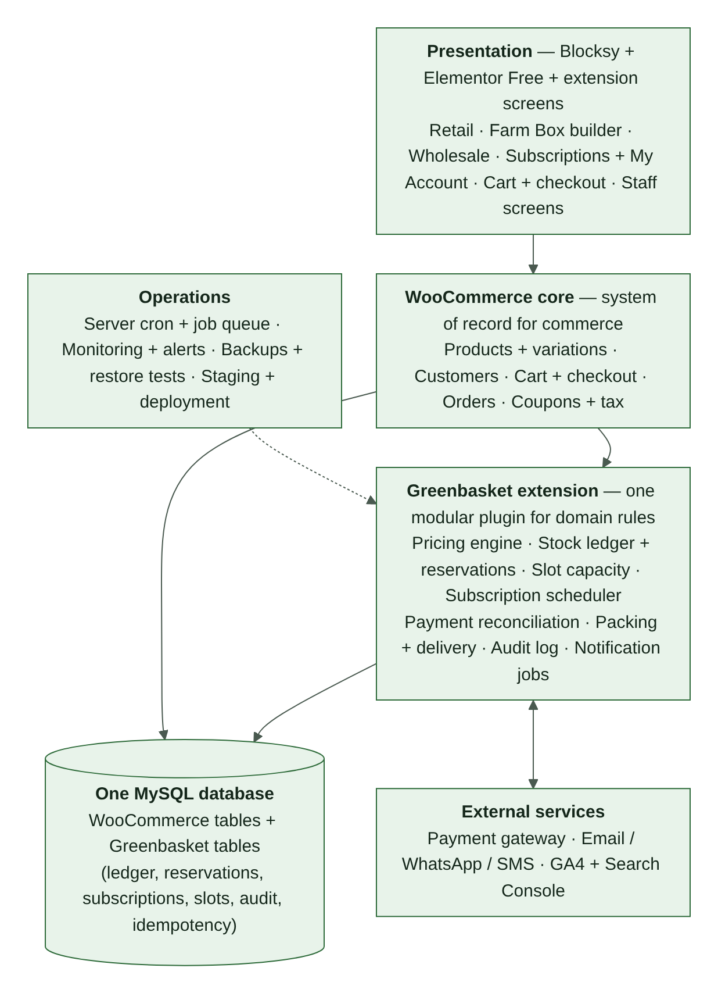

\pagebreak

# PART C — SYSTEM DESIGN

# 7. Architecture Overview

## 7.1 Architecture style

Use a **modular monolith** for the initial WordPress and WooCommerce implementation:

- one website and application;
- one authoritative commerce database;
- clear domain modules;
- custom tables for transactional data that needs reliable history, constraints, or concurrency handling;
- supported WooCommerce APIs for standard product, order and customer operations;
- asynchronous jobs for notifications, subscription schedules, reservation expiry, and reconciliation tasks.

Do not introduce separate microservices unless measured load, operational needs, or platform constraints justify them.

## 7.2 Logical layers

1. **Presentation layer:** retail pages; Farm Box builder; wholesale pages; subscription pages and account controls; cart and checkout; customer account; staff and admin screens.
2. **WooCommerce commerce layer:** products and variations; customers; cart; checkout; coupons; standard orders; tax and total calculation integration; supported order storage.
3. **Greenbasket domain layer:** selling-unit and channel eligibility rules; pricing engine; inventory ledger and reservation service; subscription scheduler; delivery-slot capacity service; payment reconciliation; packing and fulfilment workflows; notification event handling; audit logging.
4. **Persistence layer:** WordPress and WooCommerce data; custom transactional tables; audit and event records; scheduled-job records; idempotency records.
5. **External services:** payment gateway; email, WhatsApp and SMS providers; analytics; optional accounting or export services.
6. **Operations:** scheduled and background jobs; monitoring and alerting; backup and recovery; staging and deployment process; load and regression testing.

## 7.3 System boundary rule

WooCommerce remains the system of record for standard commerce orders. Greenbasket-specific tables extend the system for inventory reservations, stock movements, subscription periods and deliveries, delivery-slot reservations, payment reconciliation, and audit history.

Do not assume all WooCommerce orders are stored in legacy WordPress post tables. The implementation must support the site's configured WooCommerce order-storage mode (HPOS or posts storage — Appendix C, item C6) and use supported APIs.

## 7.4 Where each responsibility lives

**RECOMMENDATION** — confirm in Phase 1 after the Phase 0 audit.

<!-- widths: 26,37,37 -->
| Responsibility | WooCommerce | Greenbasket extension |
|---|---|---|
| Product identity, SKU, category | Authoritative | Reads |
| Selling units and base-unit conversions | Variations or product data | Conversion rules and validation |
| Channel eligibility, min/max/increment | — | Authoritative |
| Price calculation | Receives the calculated price per cart line | Pricing engine is authoritative (§10) |
| Stock availability | Display only, or switched off (§13.8) | Ledger and reservations are authoritative (§13) |
| Cart and checkout | Native flow | Adds channel context, price lock, slot and stock holds |
| Order record | Authoritative | Line context, fulfilment state, references |
| Payment processing | Gateway integration | Attempts, reconciliation, idempotency (§16) |
| Delivery slots | — | Authoritative (§15) |
| Subscriptions | Order foundation for delivery orders | Plans, periods, baskets, deliveries — or an approved subscription plugin, decided in Phase 1 |
| Notifications | Native emails where suitable | Event queue, WhatsApp, SMS, retries (§17) |
| Audit | — | Append-only audit events for every critical change |

## 7.5 Background jobs

Background work must run on time even when nobody is visiting the site.

- Trigger scheduled jobs from a real server cron at a fixed interval. WordPress's built-in scheduler only runs when pages are visited, so it is not reliable enough on its own (RK-04).
- Every job is idempotent and recoverable. A job that runs twice, or restarts halfway, never duplicates a stock movement, charge, order or message.
- Availability checks treat a reservation whose expiry time has passed as inactive even if the expiry job has not yet run. A late job can therefore never lock up stock or slot capacity.
- The maximum acceptable delay for each job is set in Phase 1. Job lag is monitored (§23.3).

<!-- widths: 34,66 -->
| Job | Purpose |
|---|---|
| Reservation expiry | Expire stock reservations (R4, R10) and slot holds (L3); release capacity |
| Payment reconciliation sweep | Look up pending and review-required attempts with the gateway; apply verified results |
| Subscription cutoff | Freeze baskets at cutoff and generate delivery orders (§12.7) |
| Renewal and retries | Charge due periods; run the retry schedule (§12.8) |
| Notification queue | Send queued messages with retries (§17.3) |
| Exception-case watchdog | Alert when a case passes its response target (OD-54) |
| Health checks | Confirm backups completed, cron running, queues not stuck |

# 8. Functional Modules

Each module lists its responsibilities and rules. Rules added in v2.0 are marked **(v2)**.

## 8.1 Catalogue module

Responsibilities: canonical product identity and SKU; category and product status; selling units and pack sizes; base-unit conversion; channel eligibility; tax classification; product-specific minimum, maximum and increment rules; availability presentation; product content fields (§20.1).

Rules:

- one canonical product is reused across channels where it is the same physical product;
- do not duplicate product records solely to show different channel prices;
- separate product identities only where units, conversion or inventory genuinely require them;
- validate every selling unit server-side;
- **(v2)** base units are whole-number units — grams, millilitres or pieces — so stock is never fractional;
- **(v2)** the rule for packs that weigh less than stated comes from OD-57 and is enforced on the packing screen.

## 8.2 Retail module

Responsibilities: display retail-eligible products; show pack and piece options; fixed selected-unit prices; quantity selection; shared cart integration; availability display.

Rules:

- pack price is fixed;
- actual packed weight does not change the customer price;
- stock deduction uses nominal pack quantity;
- unavailable or invalid variations cannot be purchased.

## 8.3 Farm Box module

Responsibilities: eligible product catalogue; product and quantity selection; live estimate of basket value; saved basket templates; restore and edit a basket; shared cart integration.

Rules:

- no Farm Box-specific minimum at initial launch unless the owner approves otherwise;
- the basket uses eligible selling units only;
- a saved basket does not reserve stock or guarantee price;
- prices, eligibility and stock are revalidated when the customer checks out, and any change is shown before payment;
- the origin label is preserved on each line;
- compatible mixed carts are allowed;
- **(v2)** the Farm Box price source is OD-33;
- **(v2)** saving a basket requires an account if OD-30 is confirmed; saved baskets are stored as versioned templates (§9.1).

## 8.4 Wholesale module

Responsibilities: public wholesale access; product-specific tier display; quantity minimum, maximum and increment enforcement; aggregation of the same product and selling unit across cart lines; applying the qualifying tier rate to all qualifying units; mixed carts; an auditable manual quote and override workflow.

Rules:

- different products are never combined;
- different selling units are not combined unless an explicit approved conversion or aggregation rule exists;
- tier rates and boundaries remain configurable;
- the server recalculates the tier after any relevant cart change;
- quote overrides require actor, reason, amount, approval, and validity or expiry where applicable;
- **(v2)** which lines aggregate is OD-26;
- **(v2)** the tier table shown to the customer comes from the same price rules the server uses, so displayed and charged prices cannot differ.

## 8.5 Subscription module

Responsibilities: plan catalogue; billing and delivery cadence; product allowance; eligible product list; saved basket and versions; cutoff handling; delivery schedule; recurring payment attempt records; retry policy; pause, skip, cancel and edit controls; generated delivery orders.

Rules:

- fixed plan price per billing period;
- the product basket cannot exceed the monetary allowance;
- delivery and applicable taxes are separate according to confirmed plan rules;
- the basket is frozen at cutoff; if the cutoff is missed, the last saved basket is used;
- monthly billing with weekly delivery creates one delivery order per delivery, linked to one subscription period;
- skipping a weekly delivery in a monthly plan does not automatically reduce the monthly charge;
- failed renewal: up to three retries over three days, then future deliveries pause;
- gateway support and applicable recurring-payment requirements must be verified before automatic renewals are enabled;
- no duplicate charge or delivery order on retried jobs or callbacks;
- **(v2)** subscription enrolment is a separate checkout; it is never mixed into a one-time cart;
- **(v2)** open rules: allowance scope (OD-19), delivery charge and period definition (OD-20), deliveries during retries (OD-21), retry counting (OD-22), invalid basket at cutoff (OD-24), recurring slot (OD-29), pause and cancel semantics (OD-46, OD-47).

## 8.6 Shared cart and checkout

Responsibilities: combine compatible retail, Farm Box and wholesale lines; preserve line-level channel and pricing context; calculate authoritative totals on the server; validate stock, price, coupon, delivery address, slot, tax, and payment method; snapshot price and rule versions; manage the 15-minute checkout price lock; reserve stock and slot; prevent duplicate submission.

Rules:

- subscription enrolment and renewal are distinct transactions. A subscription delivery order may use the shared WooCommerce order and fulfilment foundation but must reference the subscription and billing period;
- **(v2)** the channel is part of each cart line's identity, so the same product added from two channels stays on two lines with their own context;
- **(v2)** the Place Order action is idempotent: double-clicks and browser retries cannot create two orders or two payment attempts.

## 8.7 Inventory module

Responsibilities: on-hand balances; active reservations; stock movements; manual adjustments; expiry and release; packing variance; reconciliation; audit trail.

Rules:

- one shared pool per canonical product and base unit;
- available = on-hand minus active reservations;
- atomic stock check and reservation;
- 15-minute unpaid reservation by default; the timeout is configurable;
- a late payment after expiry enters review;
- actual pack weight does not alter the customer price; nominal stock deduction is used for the selected pack; actual weight, if measured, is recorded separately for variance;
- no duplicate stock movement on retries;
- reservation expiry is processed by recoverable background jobs;
- **(v2)** expiry is also enforced at read time (§7.5);
- **(v2)** a shortage found at packing releases the unfilled quantity and records a stock correction (§13.4).

## 8.8 Payment module

Responsibilities: online gateway integration; COD eligibility and confirmation; bank-transfer pending state and verification; payment attempts; callback verification; reconciliation; refunds and refund review; idempotency.

Rules:

- a gateway redirect is not proof of payment;
- an ambiguous payment stays pending or review-required;
- do not prompt a second payment while the first attempt is ambiguous;
- a bank-transfer order cannot be packed before verified payment, except through an explicitly authorized exception;
- payment callback replay must not duplicate processing;
- refund requests are support-reviewed; the published policy and applicable legal and provider requirements govern outcomes;
- **(v2)** an order has at most one active payment attempt at a time; a retry creates a new attempt only after the previous one is final (§11.2);
- **(v2)** duplicate payments, disputes, COD collection and bank-transfer verification are handled as specified in §16.

## 8.9 Delivery module

Responsibilities: service-area validation; configurable cutoff by date and slot; slot creation and capacity; temporary slot reservation at checkout; subscription capacity protection; packing batches; delivery assignment; proof of delivery; failed-delivery records.

Rules:

- service area is Chandigarh, Mohali, Panchkula;
- operating hours are 6 AM to 10 PM, every day;
- slot reservation is independent of stock reservation;
- capacity checks are concurrency-safe;
- subscriptions receive protected capacity before regular orders use the remaining capacity;
- slot reservations are released when checkout expires or the order cannot be confirmed;
- an order is not marked fully fulfilled while a shortage exception remains unresolved;
- **(v2)** the service area is validated by PIN code (OD-27) before slots are shown;
- **(v2)** rescheduling holds the new slot before releasing the old one, so a customer is never left without a slot.

## 8.10 Operations and audit module

Responsibilities: packing lists; item-level packing status; delivery assignment and outcome; payment reconciliation queue; shortage exception cases; refund and cancellation review; staff roles; audit events; operational exports; **(v2)** COD cash reconciliation; **(v2)** support tooling.

Required records: packing lists; delivery records; applicable GST invoice and credit-note records after CA validation; audit trail for price, stock, payment and order changes.

## 8.11 Customer account module (v2)

Responsibilities: one account across all experiences (CP-04); addresses; order history and tracking; saved Farm Boxes; subscriptions (basket, skip, pause, resume, cancel, payment method); refund requests and their status; communication preferences and consent (§17.4).

Rules: guest checkout stays available for one-time purchases (CP-02); customers can create an account after a guest order; account deletion and data export follow OD-17 and LG-06.
