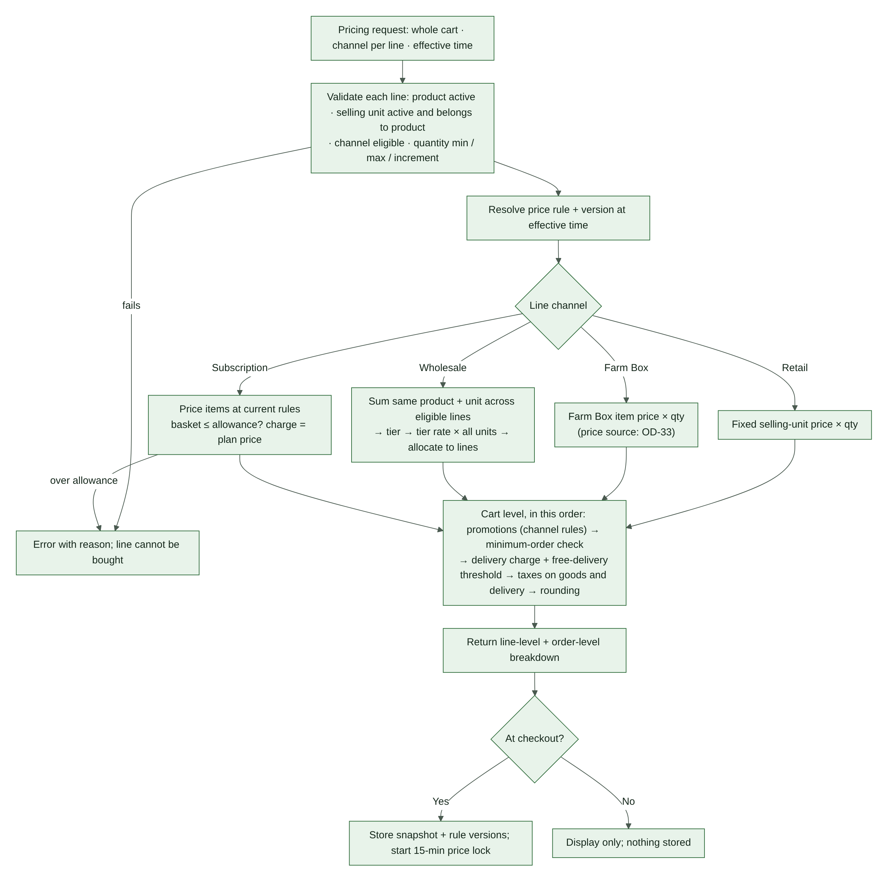

# 9. Data Model

This is a logical schema. Do not implement SQL until Phase 1 approves the exact schema, WooCommerce storage mode, constraints, indexes, and migration and rollback strategy. Entities and fields added in v2.0 are marked **(v2)**. Money fields are in paise and timestamps in UTC (§0.4).

## 9.1 Catalogue, pricing and saved baskets

<!-- widths: 20,26,54 -->
| Entity | Purpose | Fields |
|---|---|---|
| Product | Canonical product | product_id, sku, name, category_id, base_unit, tax_class, tax_status, active_status, created_at, updated_at |
| SellingUnit | What the customer buys | selling_unit_id, product_id, unit_type (pack, piece, bunch, kg, g…), nominal_quantity, base_unit_conversion, retail_price, active_status, valid_from, valid_until |
| ChannelEligibility | Which channels may sell a product | product_id, channel, eligible, min_quantity **(v2)**, max_quantity **(v2)**, quantity_increment **(v2)**, valid_from, valid_until |
| PriceRule | Versioned price per product, unit and channel | price_rule_id, product_id, selling_unit_id, channel, price, currency, valid_from, valid_until, version, created_by |
| WholesaleTier | Quantity band | tier_id, product_id, selling_unit_id, min_quantity, max_quantity (null = open-ended top tier), unit_price, valid_from, valid_until, version |
| SubscriptionPlan | Plan definition | plan_id, name, billing_interval, delivery_interval, fixed_period_price, product_allowance, allowance_scope **(v2, OD-19)**, active_status, valid_from, valid_until |
| SubscriptionEligibility | Products a plan allows | plan_id, product_id, selling_unit_id (if unit-specific), min_quantity, max_quantity, quantity_increment |
| SavedBasket **(v2)** | Farm Box template (FB-04, FB-05) | saved_basket_id, customer_id, name, version, created_at, updated_at |
| SavedBasketItem **(v2)** | Line in a saved basket | saved_basket_id, product_id, selling_unit_id, quantity |
| Promotion **(v2)** | Coupon or promotion with channel rules | promotion_id, code, eligible_channels, stackable, rule_definition, valid_from, valid_until, version (OD-44) |

## 9.2 Inventory

<!-- widths: 20,26,54 -->
| Entity | Purpose | Fields |
|---|---|---|
| InventoryBalance | Current on-hand per product | product_id, base_unit, on_hand_quantity, reserved_quantity (derived or cached only if consistency rules are defined), updated_at, version (optimistic concurrency if appropriate) |
| InventoryMovement | Append-only stock history | movement_id, product_id, quantity_delta, base_unit, movement_type (initial_stock, restock, fulfilment_deduction, shortage_correction, waste, stocktake_correction, return_restock, cancellation_reversal, authorized_correction), reason, source_type, source_id, actor_id, created_at, idempotency_key |
| StockReservation | Hold on stock for one order line | reservation_id, checkout_reference **(v2)**, order_id (null until the order exists **(v2)**), order_item_id, product_id, quantity_base_unit, status (§11.3), created_at, expires_at, extension_count **(v2)**, extension_reason **(v2)**, confirmed_at, consumed_quantity **(v2)**, released_quantity **(v2)**, release_reason **(v2)**, released_at, idempotency_key |
| PackingRecord | What was packed | packing_record_id, order_id, order_item_id, product_id, nominal_quantity, actual_quantity (nullable), packed_quantity, shortage_quantity, packed_by, packed_at |
| InventoryAdjustment | Manual change request | adjustment_id, product_id, quantity_delta, reason, created_by, approved_by, created_at |

**(v2) Why the reservation reference changed:** in v1.0 a reservation pointed at an order, but stock is reserved during checkout (§12.1 step 5), before the order exists. A reservation now points at the checkout first and is linked to the order when the order is created.

## 9.3 Orders, payments and refunds

Use WooCommerce order and order-item records for the canonical commerce transaction. Add structured metadata or custom tables for:

<!-- widths: 20,26,54 -->
| Entity | Purpose | Fields |
|---|---|---|
| OrderLineContext **(v2)** | Greenbasket context per order line | order_item_id, order_id, channel, price_rule_id, price_rule_version, price_lock_id, reservation_id, subscription_delivery_id (if any), fulfilment_status, packed_quantity, shortage_quantity |
| OrderFulfilment **(v2)** | Fulfilment state kept apart from payment state | order_id, fulfilment_status (§11.1), slot_reservation_id, review_reason, updated_at |
| PriceLock **(v2)** | 15-minute checkout price lock (CP-12) | price_lock_id, checkout_reference, customer_reference, snapshot (lines, unit prices, tiers, promotions, delivery fee, tax, totals), rule_versions, created_at, expires_at, status (active, expired, consumed), order_id |
| PaymentAttempt | One try to pay | payment_attempt_id, order_id, method (online, cod, bank_transfer) **(v2)**, attempt_no **(v2)**, gateway, gateway_transaction_id, amount, currency, status (§11.2), failure_reason **(v2)**, idempotency_key, created_at, updated_at, last_reconciled_at |
| PaymentReconciliation | Result of checking with gateway or bank | reconciliation_id, payment_attempt_id, gateway_reference, result, review_status, reviewed_by, reviewed_at, notes |
| CodCollection **(v2)** | Cash or UPI collected at the door | cod_collection_id, order_id, amount_due, amount_collected, method (cash, upi), collected_by, collected_at, handed_over_at, reconciled_by, variance, status |
| BankTransferVerification **(v2)** | Checking a bank credit | verification_id, order_id, payment_reference, amount_expected, amount_received, bank_reference, verified_by, verified_at, status, exception_approved_by, exception_reason |
| RefundRequest | Request for money back | refund_request_id, order_id, payment_attempt_id, source (customer, system) **(v2)**, reason, requested_amount, approved_amount **(v2)**, status (§11.7), reviewed_by, resolution_reference, created_at, resolved_at |
| RefundTransaction **(v2)** | One refund payout | refund_transaction_id, refund_request_id, payment_attempt_id, amount, method (gateway, upi, bank_transfer, store_credit), gateway_refund_id, status (pending, succeeded, failed), idempotency_key, created_at, completed_at |
| Dispute **(v2)** | Chargeback or bank dispute | dispute_id, payment_attempt_id, gateway_dispute_id, amount, reason, status, response_deadline, outcome, handled_by |
| QuoteRequest **(v2)** | Wholesale quote (OD-14) | quote_id, customer_id, lines, quoted_prices, requested_at, approved_by, valid_until, status, converted_order_id |

## 9.4 Subscriptions

<!-- widths: 20,26,54 -->
| Entity | Purpose | Fields |
|---|---|---|
| Subscription | The customer's plan | subscription_id, customer_id, plan_id, status (§11.5), billing_interval, delivery_interval, next_billing_at, next_delivery_at, cutoff_rule_id, preferred_slot **(v2, OD-29)**, payment_method_reference, paused_from **(v2)**, cancel_effective_at **(v2)**, created_at, updated_at |
| SubscriptionPeriod | One billing period | period_id, subscription_id, period_start, period_end, fixed_charge, payment_status, payment_attempt_reference, retry_count **(v2)** |
| SubscriptionBasket | Versioned basket | basket_id, subscription_id, version, created_at, updated_at |
| SubscriptionBasketItem | Line in a basket version | basket_id, product_id, selling_unit_id, quantity, snapshot_price, snapshot_rule_version |
| SubscriptionDelivery | One delivery instance | subscription_delivery_id, subscription_id, period_id, delivery_date, basket_version **(v2)**, basket_snapshot, allowance_snapshot **(v2)**, generated_order_id, status (§11.6), slot_reservation_id, created_at |
| CutoffRule **(v2)** | Defines a cutoff (v1.0 referenced it without defining it) | cutoff_rule_id, applies_to (slot, subscription_delivery), rule (fixed time or offset before slot start), valid_from, valid_until |

## 9.5 Delivery

<!-- widths: 20,26,54 -->
| Entity | Purpose | Fields |
|---|---|---|
| ServiceArea **(v2)** | PIN codes served (OD-27) | pincode, zone, active, valid_from, valid_until |
| DeliverySlot | A delivery window | slot_id, delivery_date, start_time, end_time, service_zone, total_capacity, subscription_protected_capacity, status, cutoff_at |
| SlotReservation | Hold on slot capacity | slot_reservation_id, slot_id, checkout_reference **(v2)**, order_id or subscription_delivery_id, reservation_type (regular, subscription) **(v2)**, capacity_units, status (§11.4), created_at, expires_at, confirmed_at, released_at |
| DeliveryAssignment | Driver allocation | delivery_assignment_id, order_id, assigned_to, route_reference, status, out_for_delivery_at, delivered_at, proof_reference, failure_reason |
| DeliveryAttempt **(v2)** | Each attempt, including failures | attempt_id, order_id, delivery_assignment_id, slot_id, attempt_no, outcome (delivered, failed), failure_reason, proof_reference, attempted_at |

**(v2) Regular capacity is derived, not stored:** regular capacity = total_capacity − subscription_protected_capacity. Storing all three numbers (as v1.0 did) lets them disagree.

## 9.6 Audit, consent and asynchronous processing

<!-- widths: 20,26,54 -->
| Entity | Purpose | Fields |
|---|---|---|
| AuditEvent | Who changed what | event_id, actor_type, actor_id, action, entity_type, entity_id, before_value, after_value, reason, created_at |
| NotificationJob | One message to send | notification_job_id, event_id, channel, recipient_reference, message_type (transactional, marketing) **(v2)**, status, attempt_count, next_attempt_at, provider_reference, last_error |
| ConsentRecord **(v2)** | Marketing and messaging consent (LG-06) | consent_id, customer_id, channel (email, whatsapp, sms, push), purpose (marketing), status (granted, withdrawn), source, policy_version, captured_at, withdrawn_at |
| IdempotencyRecord | Prevents duplicates | idempotency_key, operation_type, source_reference, result_reference, status, created_at, completed_at |
| ExceptionCase | A problem needing a person | case_id, case_type (§11.8), order_id, subscription_id, status, assigned_to, resolution, due_at **(v2)**, created_at, resolved_at |

## 9.7 Data integrity requirements

- Define foreign keys or equivalent application-level integrity controls where supported.
- Add indexes for order IDs, product IDs, reservation status and expiry, subscription due dates, delivery slots, and gateway transaction references.
- Use unique constraints for idempotency keys and external transaction references (gateway transaction ID, gateway refund ID, bank reference).
- Do not store card PAN or CVV.
- Keep audit records append-only; do not silently overwrite history.
- Preserve order and subscription snapshots even if product prices later change.
- Design migrations with rollback and recovery instructions.
- Do not assume all data belongs in WordPress post metadata; choose structured storage for transactional workloads.
- **(v2)** Status values may only change through the transitions in §11; any other change is rejected and logged.
- **(v2)** Availability queries ignore reservations whose expires_at has passed, whatever their stored status (§7.5).

# 10. Pricing Engine Specification

## 10.1 Inputs

A pricing request covers the **whole cart**, because wholesale tiers depend on other lines. It includes: product ID, selling-unit ID, quantity and channel for every line; customer or account context where relevant; subscription plan and period context if relevant; coupon and promotion context; effective time; delivery and tax context (address, slot).

## 10.2 Validation and calculation order

1. Confirm the product is active.
2. Confirm the selling unit is active and belongs to the product.
3. Confirm the product is eligible for the line's channel.
4. Validate quantity minimum, maximum and increment for that channel.
5. Resolve the applicable price rule and version at the effective time.
6. Calculate each line by channel: retail fixed price (§10.3); Farm Box price (§10.4); wholesale — aggregate the same product and selling unit across the relevant lines (OD-26), resolve the tier, apply the tier rate to all aggregated units, then allocate back to lines (§10.5); subscription — price the basket at current rules and verify eligibility and the monetary allowance (§10.6).
7. Apply permitted coupon and promotion rules (§10.7).
8. Check the minimum order (§10.8).
9. Calculate the delivery fee and free-delivery logic (§10.8).
10. Calculate applicable taxes on goods and delivery according to configured tax rules (§10.9).
11. Apply the rounding rule (OD-50).
12. Return a line-level and order-level breakdown.
13. At checkout, store the price snapshot and rule versions, and start the price lock (§10.10).

If any of steps 1–4, or the subscription allowance check, fails, return an error with a reason code (§10.11); the line cannot be bought. The exact tax and discount sequence must be verified against the configured WooCommerce tax setup and applicable requirements. Do not invent tax treatment.

> **(v2) Changes from the owner-supplied pricing diagram.** (a) Wholesale aggregation is a cart-level step; the diagram priced each line on its own, which cannot add up quantities across lines (WS-04). (b) The delivery charge is now calculated before tax, because delivery may itself be taxable; the diagram taxed first. (c) Missing steps added: price-rule version, minimum order, rounding, snapshot and price lock, and the error path.

## 10.3 Retail formula

`line_subtotal = selected_selling_unit_price × quantity`

The selected pack price remains fixed even when actual packed weight differs.

## 10.4 Farm Box formula (v2)

`line_subtotal = farm_box_unit_price × quantity`, where `farm_box_unit_price` is the retail selling-unit price unless a Farm Box price rule exists (OD-33). A saved basket stores products, units and quantities only — never prices (FB-05).

## 10.5 Wholesale formula

For each eligible product and selling unit:

1. Aggregate eligible quantities across cart lines.
2. Resolve the tier for the aggregate quantity.
3. Apply that tier's unit rate to all aggregated units.
4. Allocate the result back to line snapshots for order and reporting, while preserving the correct aggregate basis.

Because one rate applies to every unit, allocation is exact: each line's amount = tier rate × that line's quantity, and the line amounts always add up to the aggregate total.

Example only: 5 kg + 7 kg of the same product and selling unit = 12 kg. If the 10–24 kg tier is ₹45/kg, the total is ₹540 (lines of ₹225 and ₹315). Actual tier rates and boundaries remain undecided (OD-01). Do not aggregate different products or different units without explicit rules.

## 10.6 Subscription allowance

- `eligible_basket_value` must not exceed `plan_product_allowance` (scope per OD-19).
- A basket above the allowance is blocked until edited.
- The allowance is not an extra charge; the charge is the fixed plan price.
- Delivery and applicable taxes are handled separately under plan rules.
- Preserve price and allowance snapshots for each subscription period and delivery.
- Define how a period's prices are locked and how updated prices apply to the next period before enabling subscriptions.

## 10.7 Promotions (v2)

- Coupons are validated on the server against their channel rules and validity window (OD-44).
- The promotion version used is stored in the snapshot.
- A promotion never lowers a line below zero or changes a wholesale tier boundary.

## 10.8 Minimum order and delivery charge (v2)

- The minimum order (OD-02) is checked on the eligible subtotal after promotions; Farm Box treatment follows OD-08.
- The delivery fee and free-delivery threshold follow OD-03, including whether the threshold uses the subtotal before or after discounts and tax.

## 10.9 Tax and rounding (v2)

- Taxes follow the configured WooCommerce tax settings, validated by the CA (OD-09). Fresh produce, processed items and delivery charges may not share the same treatment.
- One rounding function is used everywhere (OD-50). Displayed totals always equal charged totals.

## 10.10 Price-lock rule

- Checkout price lock duration: 15 minutes.
- Recalculate and validate on the server at checkout start.
- Store the snapshot, rule versions and expiry.
- If the lock expires before payment initiation, recalculate and require customer confirmation of changes.
- If a gateway response is delayed after payment initiation, reconcile the attempt against the original attempt and snapshot. Do not silently charge a different amount.
- Never trust browser-submitted totals.
- **(v2)** The lock covers line prices, tiers, promotions, delivery fee, tax and the total.
- **(v2)** If the cart changes during the lock, the server reprices it (wholesale tiers included), shows the customer what changed, and starts a new lock.

## 10.11 Error reason codes (v2)

`product_inactive`, `unit_invalid`, `not_eligible_for_channel`, `quantity_below_minimum`, `quantity_above_maximum`, `quantity_not_increment`, `price_rule_missing`, `over_allowance`, `promotion_invalid`, `below_minimum_order`, `outside_service_area`. Each code has a plain-language customer message (§18.5).
