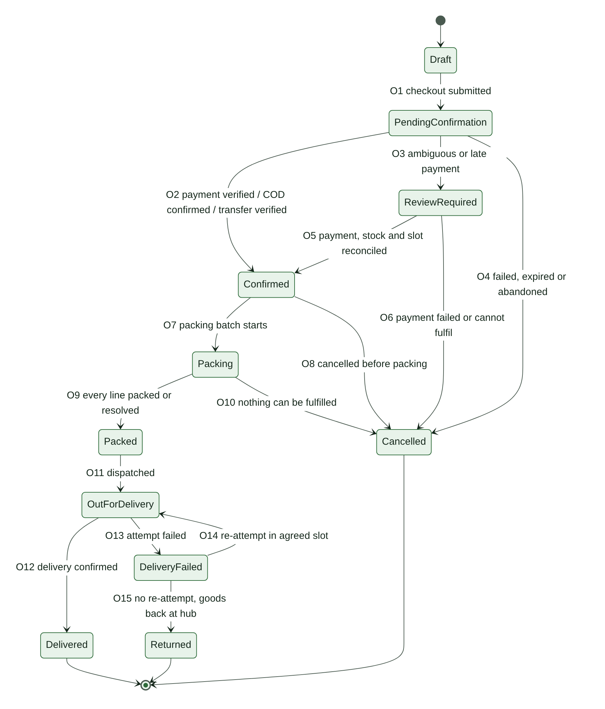
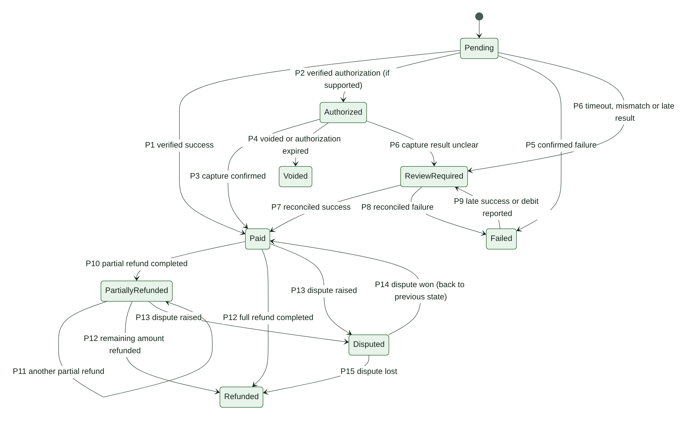
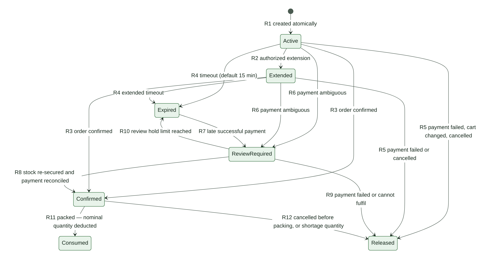
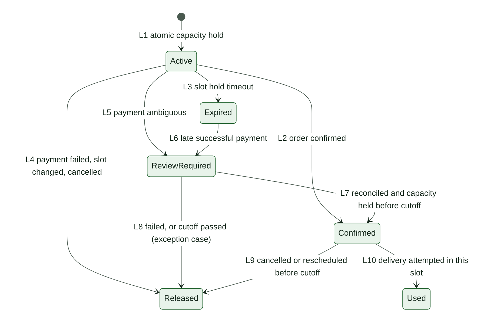
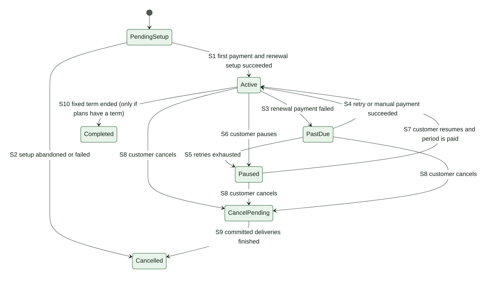
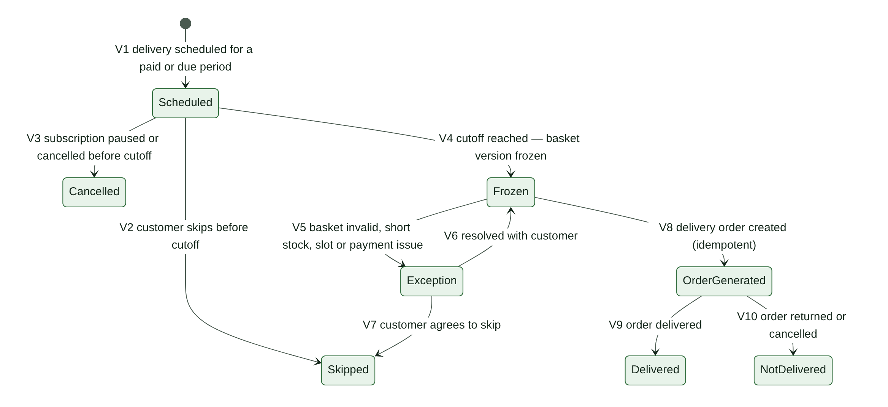
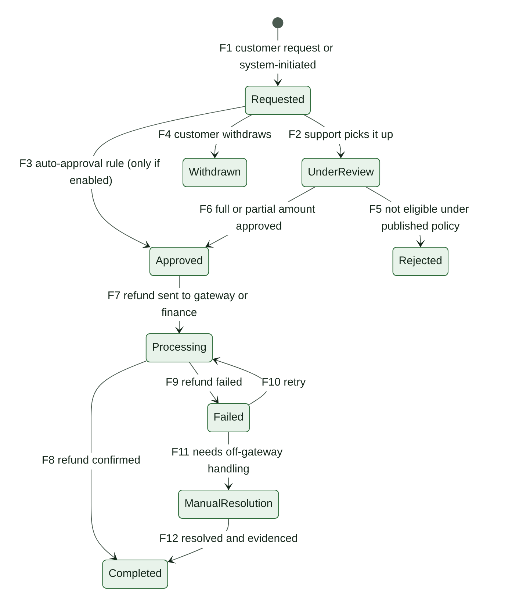

\pagebreak

# 11. State Machines

Greenbasket tracks several things that each have their own lifecycle. They must stay separate. One combined status would hide important facts: an order can be delivered *and* partly refunded, or paid *and* waiting for stock review.

<!-- widths: 26,74 -->
| State machine | Tracks |
|---|---|
| Order (§11.1) | Where the goods are: confirmation, packing, delivery |
| Payment attempt (§11.2) | Where the money is for one try to pay |
| Stock reservation (§11.3) | The hold on stock for one order line |
| Slot reservation (§11.4) | The hold on delivery capacity for one order |
| Subscription (§11.5) | The customer's plan |
| Subscription delivery (§11.6) | One scheduled delivery of a subscription |
| Refund request (§11.7) | One request for money back |
| Exception case (§11.8) | One problem that needs a person |

Rules that apply to every state machine:

- A status changes only through a transition listed here. Any other change is rejected and logged.
- Every transition is idempotent and writes an audit event: actor, before, after, reason, time.
- A "guard" must be true for the transition to happen. "Effects" are what the system does as part of the same change.
- Section §11.9 lists how the machines affect each other.

## 11.1 Order (fulfilment)

<!-- widths: 20,50,30 -->
| State | Meaning | WooCommerce status (RECOMMENDATION, OD-45) |
|---|---|---|
| Draft | Cart or checkout in progress; not visible to staff as an order | Cart session or checkout draft |
| PendingConfirmation | Submitted; waiting for payment verification, COD confirmation or transfer verification | Pending payment (online); On hold (bank transfer) |
| ReviewRequired | Needs staff reconciliation: ambiguous, late or mismatched payment, or stock or slot could not be re-secured | On hold, with a review reason |
| Confirmed | Payment verified, COD confirmed, or transfer verified; stock and slot confirmed | Processing |
| Packing | Being picked and packed | Custom status "Packing" |
| Packed | Every line packed or resolved | Custom status "Packed" |
| OutForDelivery | With a driver | Custom status "Out for delivery" |
| DeliveryFailed | A delivery attempt failed | Custom status "Delivery failed" |
| Delivered | Handed over with proof | Completed |
| Returned | Goods came back to the hub; final | Custom status "Returned" |
| Cancelled | Final; nothing will be delivered | Cancelled |

WooCommerce may set its own "Refunded" status when an order is fully refunded. Greenbasket keeps the fulfilment state in its own field (OrderFulfilment, §9.3) so delivery history is never lost. Custom statuses must be verified against the site's order storage mode in Phase 1.

<!-- widths: 6,17,20,27,30 -->
| ID | From → To | Trigger | Guard | Effects |
|---|---|---|---|---|
| O1 | Draft → PendingConfirmation | Customer places the order | Server repricing passed; price lock valid or changes confirmed by the customer; stock and slot reservations active; payment method eligible | Create the WooCommerce order; link reservations and price lock to it; create a payment attempt or start the COD or bank-transfer flow |
| O2 | PendingConfirmation → Confirmed | Online payment verified, COD confirmed (OD-49), bank transfer verified, or authorized bank-transfer exception | Amount matches the snapshot; stock and slot reservations still Active or Extended | Reservations → Confirmed (R3, L2); confirmation notification queued |
| O3 | PendingConfirmation → ReviewRequired | Payment ambiguous, amount mismatch, or payment succeeded after the reservation expired | — | Reservations held for review (R6, L5) or flagged (R7); exception case opened; customer told payment is being verified and is not asked to pay again |
| O4 | PendingConfirmation → Cancelled | Payment confirmed failed and not retried, reservations expired with no payment, customer abandoned, or bank-transfer window ended | No payment is Paid or ReviewRequired | Release reservations (R5, L4); payment attempt final |
| O5 | ReviewRequired → Confirmed | Review resolved | Payment Paid; stock re-secured (R8); slot held before its cutoff, or the customer agreed a new slot | Reservations → Confirmed; exception case resolved |
| O6 | ReviewRequired → Cancelled | Payment reconciled as failed, or paid but cannot be fulfilled and the customer declines alternatives | — | Release reservations; if paid, open a system refund request (F1) |
| O7 | Confirmed → Packing | Packing starts for the order's slot | Bank transfer verified or exception recorded (CP-09) | Lines enter picking |
| O8 | Confirmed → Cancelled | Customer cancels before packing (CP-15), or staff cancel with a reason | Cancellation policy allows it | Release reservations (R12, L9); if paid, open a system refund request |
| O9 | Packing → Packed | Every line packed or its shortage resolved | No open shortage exception on the order | Packed quantity consumed (R11); shortage quantity released with stock correction (R12); amount changes go to a refund request or reduce the COD amount due |
| O10 | Packing → Cancelled | Nothing can be fulfilled, or the customer cancels after shortage contact | Recorded customer decision or approved default action (OD-28) | Release reservations; refund if paid |
| O11 | Packed → OutForDelivery | Dispatched to an assigned driver | Delivery assignment exists | Out-for-delivery notification |
| O12 | OutForDelivery → Delivered | Handover confirmed | Proof of delivery captured (OD-40); COD collection recorded if due | Slot hold Used (L10); delivered notification; refund window opens (OD-37) |
| O13 | OutForDelivery → DeliveryFailed | Attempt failed (not available, wrong address, refused, no access) | Reason and proof recorded | Delivery attempt saved; customer notified; exception case opened |
| O14 | DeliveryFailed → OutForDelivery | Re-attempt dispatched | Policy allows it (OD-16); customer agreed a new slot, held atomically | New slot reservation; attempt number increases |
| O15 | DeliveryFailed → Returned | No re-attempt | Goods received back at the hub | Stock disposition: restock or waste movement; refund or charges per OD-16 |

**Differences from the owner-supplied order diagram:** (1) a failed-delivery path (DeliveryFailed, Returned) was added, because DL-12 requires failed-delivery workflows and the diagram had none. (2) Refund states were moved out of the order into the refund lifecycle (§11.7). In the diagram, a partially refunded order lost the fact that it had been delivered, and could not receive a second refund. (3) Cancellation from Packing (O10) was added for shortages. (4) v1.0's `ready_for_packing` state was dropped: it duplicated Confirmed, since packing is driven by the slot date.

## 11.2 Payment attempt

{landscape}

<!-- widths: 20,55,25 -->
| State | Meaning | Applies to |
|---|---|---|
| Pending | Attempt created; result not yet known. For COD: awaiting collection. For bank transfer: awaiting the credit. | All methods |
| Authorized | Funds authorized but not captured | Online, only if the gateway and method support it (OD-36) |
| Paid | Money received and verified | All methods |
| Failed | Final failure for this attempt (declined, abandoned and confirmed unpaid, not collected, transfer not received) | All methods |
| Voided | Authorization released before capture | Online with authorization |
| ReviewRequired | Result unclear or inconsistent; a person must reconcile | All methods |
| PartiallyRefunded | Some money returned; derived from completed refund transactions | Paid attempts |
| Refunded | All money returned | Paid attempts |
| Disputed | Customer's bank raised a dispute or chargeback | Online |

<!-- widths: 6,20,22,24,28 -->
| ID | From → To | Trigger | Guard | Effects |
|---|---|---|---|---|
| P1 | Pending → Paid | Verified success: signed callback or server status lookup; COD collection recorded; bank credit verified | Amount, currency and order match the snapshot; event not processed before | Order O2 (or O5); idempotency record saved |
| P2 | Pending → Authorized | Verified authorization | Gateway supports authorization for this method | Capture scheduled per OD-36 |
| P3 | Authorized → Paid | Capture confirmed | Captured amount ≤ authorized amount | As P1 |
| P4 | Authorized → Voided | Authorization voided, or expired at the gateway | — | Order cancelled or a new attempt required |
| P5 | Pending → Failed | Gateway confirms failure; attempt window ended and lookup confirms nothing was charged; COD not collected; transfer window ended | No conflicting success signal | Release holds if the order cancels (O4); a retry creates a new attempt |
| P6 | Pending or Authorized → ReviewRequired | Timeout without a definitive status; amount or currency mismatch; success for an order already cancelled or expired | — | Order O3; exception case; no second payment prompt |
| P7 | ReviewRequired → Paid | Reconciled as success | Verified with the gateway or bank | Order O5 if stock and slot can be re-secured; otherwise O6 with refund |
| P8 | ReviewRequired → Failed | Reconciled as failure | Verified with the gateway or bank | Order O4 or O6 |
| P9 | Failed → ReviewRequired | Late success notice from the gateway, or customer reports a debit (CP-16) | — | Never marked Paid without verification; exception case |
| P10 | Paid → PartiallyRefunded | A refund transaction succeeds for less than the paid amount | — | Order fulfilment state unchanged |
| P11 | PartiallyRefunded → PartiallyRefunded | Another partial refund succeeds | Total refunded < paid amount | — |
| P12 | Paid or PartiallyRefunded → Refunded | Refund transactions total the paid amount | — | — |
| P13 | Paid or PartiallyRefunded → Disputed | Dispute notice from the gateway | — | Dispute record; response deadline tracked |
| P14 | Disputed → previous state | Dispute won | — | Dispute closed |
| P15 | Disputed → Refunded | Dispute lost (chargeback) | — | Recorded as chargeback; finance notified |

Rules:

- An order has at most one attempt in Pending, Authorized or ReviewRequired at a time. A customer retry creates a new attempt only after the previous one is final.
- If two attempts for the same order both become Paid, the second goes to ReviewRequired and its amount is refunded (§16.8).
- Refund states are derived only from succeeded refund transactions (§11.7), never set by hand.

**Differences from the owner-supplied payment diagram:** (1) a voided authorization now goes to Voided, not Failed — it is a cancellation, not a payment failure, and reporting must tell them apart. (2) Failed → ReviewRequired (P9) was added for late success and reported debits (CP-16). (3) Repeated partial refunds (P11), disputes (P13–P15) and capture-unclear (P6 from Authorized) were added. (4) COD and bank transfer were mapped onto the same states.

## 11.3 Stock reservation

{landscape}

<!-- widths: 20,80 -->
| State | Meaning |
|---|---|
| Active | Quantity held for a checkout line; counts against availability until expires_at |
| Extended | Still held, with a later expiry under an authorized extension rule |
| Confirmed | Held for a confirmed order; waiting for packing |
| ReviewRequired | Held, or needs re-securing, while a payment is reconciled |
| Expired | Timed out; no longer counts against availability |
| Released | Given back to the pool; final |
| Consumed | Deducted from on-hand at packing; final |

<!-- widths: 6,20,22,24,28 -->
| ID | From → To | Trigger | Guard | Effects |
|---|---|---|---|---|
| R1 | (new) → Active | Checkout reserves stock | Atomic: available ≥ requested quantity, for all lines together | expires_at = now + reservation timeout (default 15 min, **CONFIGURABLE**, CP-10) |
| R2 | Active → Extended | Authorized extension: online payment started near expiry (OD-34); bank transfer selected (OD-25); staff extension with reason | Extension count below the configured maximum | New expires_at; extension reason recorded |
| R3 | Active or Extended → Confirmed | Order confirmed (O2) | Not expired | confirmed_at set |
| R4 | Active or Extended → Expired | expires_at passed | Not confirmed | Quantity stops counting immediately (read-time rule, §7.5); the job records the state |
| R5 | Active or Extended → Released | Payment confirmed failed; customer changed or removed the line; checkout abandoned; order cancelled | — | release_reason recorded |
| R6 | Active or Extended → ReviewRequired | Payment ambiguous (O3) | — | Hold kept until resolved or until the review hold limit (OD-35) |
| R7 | Expired → ReviewRequired | Successful payment arrives after expiry (CP-11) | — | Late-payment exception case; dispatch blocked |
| R8 | ReviewRequired → Confirmed | Payment reconciled as Paid | Stock still held, or re-reserved atomically for the full quantity | Order O5 |
| R9 | ReviewRequired → Released | Payment failed, or the line cannot be fulfilled and the customer declines alternatives | — | Refund if paid (O6) |
| R10 | ReviewRequired → Expired | Review hold limit reached (OD-35) | Payment still unresolved | A later success follows R7 |
| R11 | Confirmed → Consumed | Line packed | — | fulfilment_deduction movement for the packed nominal quantity (idempotent) |
| R12 | Confirmed → Released | Cancelled before packing; or shortage at packing (unfilled quantity) | — | For a shortage: a shortage_correction movement reduces on-hand by the quantity that was not physically there (§13.4) |

**Differences from the owner-supplied reservation diagram:** the Extended state is kept from the diagram. Added: payment failure and cancellation from Extended (R5); a hold while payment is ambiguous (R6), which the PRD requires ("do not blindly release or consume stock"); a review hold limit (R10); and partial outcomes at packing (R11 plus R12 for the shortage quantity). Also, an expired reservation stops counting at once, even if the expiry job is late.

## 11.4 Slot reservation

States: Active (held, with its own expiry, separate from stock — DL-07), Confirmed, ReviewRequired, Expired, Released, Used. A bank-transfer order or an authorized extension keeps the hold Active with a later expiry; the extension is recorded the same way as R2.

<!-- widths: 6,20,22,24,28 -->
| ID | From → To | Trigger | Guard | Effects |
|---|---|---|---|---|
| L1 | (new) → Active | Customer selects a slot | Atomic: slot open, before cutoff, regular capacity left (subscription holds use protected capacity) | expires_at = now + slot hold timeout (**CONFIGURABLE**) |
| L2 | Active → Confirmed | Order confirmed (O2) | Hold not expired | Slot allocation confirmed |
| L3 | Active → Expired | Hold timed out | Not confirmed | Capacity freed immediately (read-time rule) |
| L4 | Active → Released | Payment failed; customer chose another slot; checkout abandoned; cancelled | — | Capacity freed |
| L5 | Active → ReviewRequired | Payment ambiguous | — | Held until the slot's cutoff at most |
| L6 | Expired → ReviewRequired | Late successful payment | — | Try to re-hold the same slot atomically |
| L7 | ReviewRequired → Confirmed | Payment reconciled as Paid | Capacity held before the slot's cutoff | Order O5 |
| L8 | ReviewRequired → Released | Payment failed, or the cutoff passed | — | Exception case: customer picks a new slot; never moved silently |
| L9 | Confirmed → Released | Cancelled or rescheduled before cutoff | For a reschedule, the new slot is held first | Capacity freed |
| L10 | Confirmed → Used | Delivery attempted in this slot | — | A re-attempt needs a new reservation (O14) |

## 11.5 Subscription

{landscape}

<!-- widths: 6,20,22,24,28 -->
| ID | From → To | Trigger | Guard | Effects |
|---|---|---|---|---|
| S1 | PendingSetup → Active | First period paid and renewal setup done | Required payment authorization or mandate succeeded (SB-12); never Active without it | First period's deliveries scheduled (V1) |
| S2 | PendingSetup → Cancelled | Setup abandoned or failed | Setup timeout reached (OD-41) | Holds released |
| S3 | Active → PastDue | Renewal payment failed | — | Retry schedule starts (§12.8) |
| S4 | PastDue → Active | Retry or manual payment succeeded | Previous attempt reconciled first; no duplicate charge | Period Paid |
| S5 | PastDue → Paused | Retries exhausted (3 over 3 days, SB-13; counting per OD-22) | — | Future deliveries paused (V3); customer notified |
| S6 | Active → Paused | Customer pauses | Effective date per OD-46 and cutoff rules | Future deliveries after the effective date cancelled; protected capacity released |
| S7 | Paused → Active | Customer resumes | Next period paid or payment set up | Deliveries scheduled from the next possible date |
| S8 | Active, Paused or PastDue → CancelPending | Customer cancels | Published terms (LG-07) | Remaining deliveries per OD-47 |
| S9 | CancelPending → Cancelled | Committed deliveries finished | — | No further charges |
| S10 | Active → Completed | Fixed term ended | Only if plans have a term (OD-48) | — |

## 11.6 Subscription delivery

{landscape}

<!-- widths: 6,20,22,24,28 -->
| ID | From → To | Trigger | Guard | Effects |
|---|---|---|---|---|
| V1 | (new) → Scheduled | Period scheduled | Subscription Active | Protected slot capacity counted (§15.3) |
| V2 | Scheduled → Skipped | Customer skips | Before cutoff | Protected capacity released; charge unchanged (SB-14) |
| V3 | Scheduled → Cancelled | Subscription paused or cancelled | Before cutoff | Protected capacity released |
| V4 | Scheduled → Frozen | Cutoff reached | — | Latest saved basket version frozen with price, allowance and rule snapshots (SB-10, SB-15) |
| V5 | Frozen → Exception | Basket invalid (OD-24), stock short, slot cannot be honoured, or period unpaid (OD-21) | — | Exception case; customer contacted; no silent substitution |
| V6 | Exception → Frozen | Resolved with the customer | Customer decision recorded | Snapshot updated as a new version |
| V7 | Exception → Skipped | Customer agrees to skip | — | Capacity released |
| V8 | Frozen → OrderGenerated | Delivery order created | Idempotency key = delivery ID; stock and slot confirmed | WooCommerce order linked to the subscription and period (SB-04) |
| V9 | OrderGenerated → Delivered | Order Delivered (O12) | — | — |
| V10 | OrderGenerated → NotDelivered | Order Returned or Cancelled | — | Credit or charge per published policy only |

## 11.7 Refund request and refund transaction

<!-- widths: 6,20,22,24,28 -->
| ID | From → To | Trigger | Guard | Effects |
|---|---|---|---|---|
| F1 | (new) → Requested | Customer request (within OD-37), or system-initiated: cancellation of a paid order, shortage, failed delivery, duplicate payment, late payment that cannot be fulfilled | Paid amount available to refund | Source and reason recorded |
| F2 | Requested → UnderReview | Support picks it up | — | Assigned reviewer |
| F3 | Requested → Approved | Auto-approval rule | Enabled by OD-38; system-calculated amount; not a customer complaint | Approval recorded as rule-based |
| F4 | Requested → Withdrawn | Customer withdraws | Not yet approved | — |
| F5 | UnderReview → Rejected | Not eligible under the published policy | Reason given to the customer | — |
| F6 | UnderReview → Approved | Full or partial amount approved | Approver has the refund permission (§22.1) | approved_amount set |
| F7 | Approved → Processing | Refund transaction created | Idempotency key per refund transaction | Sent to the gateway, or to finance for COD and bank-transfer payouts (OD-39) |
| F8 | Processing → Completed | Refund confirmed | — | Payment P10 or P12; credit note if applicable (OR-03) |
| F9 | Processing → Failed | Refund failed | — | Finance alerted |
| F10 | Failed → Processing | Retry | Retry is a new transaction with its own idempotency key | — |
| F11 | Failed → ManualResolution | Cannot complete through the gateway | — | Off-gateway payout with evidence |
| F12 | ManualResolution → Completed | Resolved and evidenced | Evidence attached | As F8 |

## 11.8 Exception case

Lifecycle: **Open → Assigned → AwaitingCustomer (optional) → Resolved → Closed.** A resolved case may be reopened with a reason. Each case type has an owner role and a response target (OD-54).

<!-- widths: 28,44,28 -->
| Case type | Raised when | Owner role |
|---|---|---|
| payment_review | Payment ambiguous or mismatched (P6) | Finance |
| late_payment | Payment succeeded after expiry or cancellation (R7, L6) | Finance + order manager |
| duplicate_payment | Two Paid attempts on one order | Finance |
| reported_debit | Customer reports a debit on a failed attempt (P9) | Customer support + finance |
| stock_shortage | Line cannot be fully packed | Packing lead + support |
| slot_capacity | Slot cannot be honoured, or capacity was reduced below allocations | Order manager |
| subscription_basket | Frozen basket invalid (V5) | Customer support |
| subscription_payment | Renewal past due or retries exhausted | Customer support |
| delivery_failed | Delivery attempt failed (O13) | Delivery lead + support |
| cod_variance | Cash handed over ≠ cash recorded | Finance |
| refund_failure | Refund transaction failed (F9) | Finance |
| dispute | Dispute or chargeback (P13) | Finance |

## 11.9 How the state machines interact

<!-- widths: 40,60 -->
| When | Then |
|---|---|
| Order becomes Confirmed (O2, O5) | Online payment Paid, or COD confirmed, or bank transfer verified or under authorized exception; every line reservation Confirmed; slot reservation Confirmed |
| A shortage exception is open on an order | The order cannot become Packed (O9) |
| A bank transfer is unverified with no recorded exception | The order cannot enter Packing (O7) |
| Payment becomes ReviewRequired | Order → ReviewRequired (O3); stock and slot holds → ReviewRequired (R6, L5) |
| Order becomes Cancelled | Every reservation not yet Consumed is released; if any payment is Paid, a system refund request is opened (F1) |
| Reservation Expired, then payment Paid | Order → ReviewRequired; dispatch blocked until stock and payment are reconciled (CP-11) |
| A refund completes | Payment state changes (P10, P12); order fulfilment state does not |
| Subscription Paused or Cancelled | Scheduled deliveries after the effective date → Cancelled (V3); protected capacity released |
| Subscription PastDue | Upcoming deliveries follow OD-21 |
| Any transition | Audit event written in the same database transaction |
