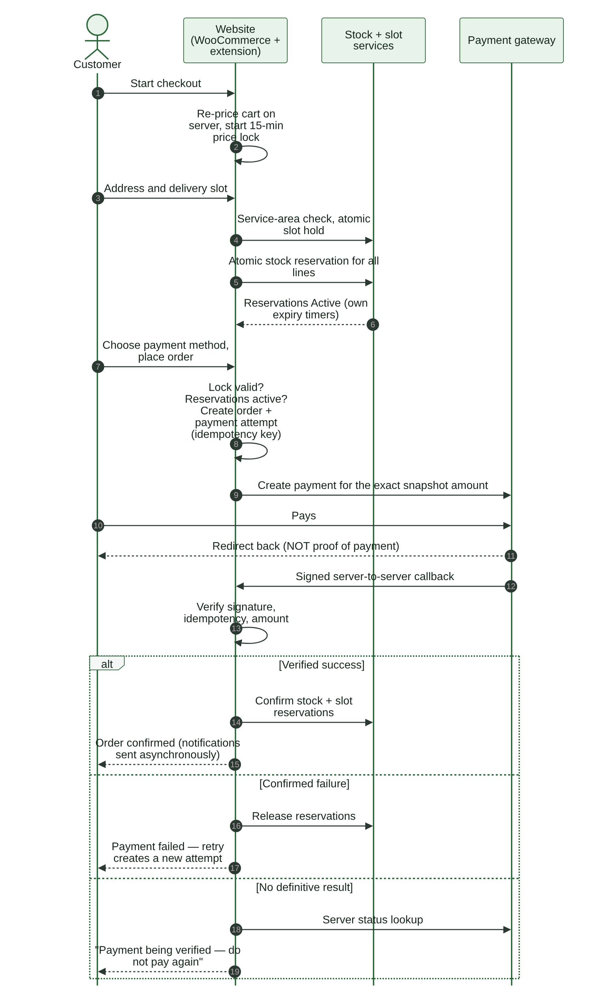
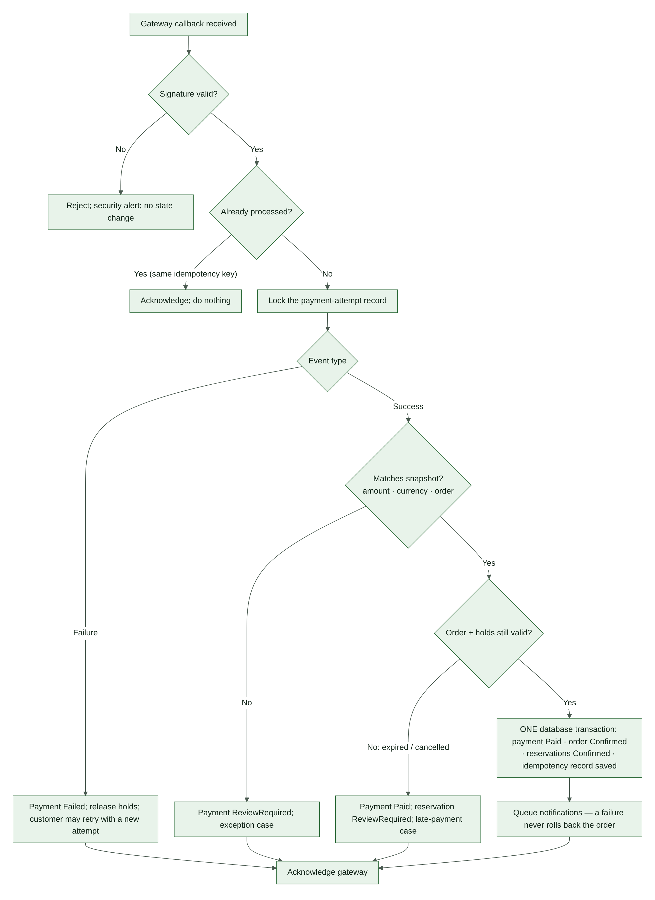
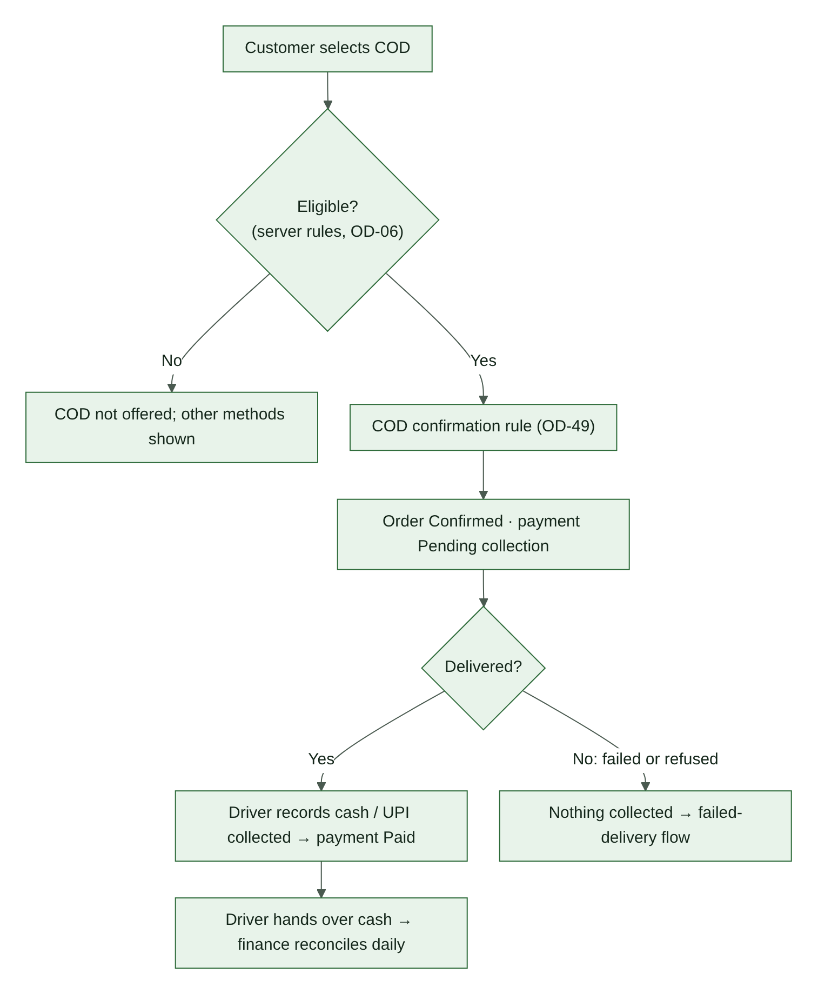
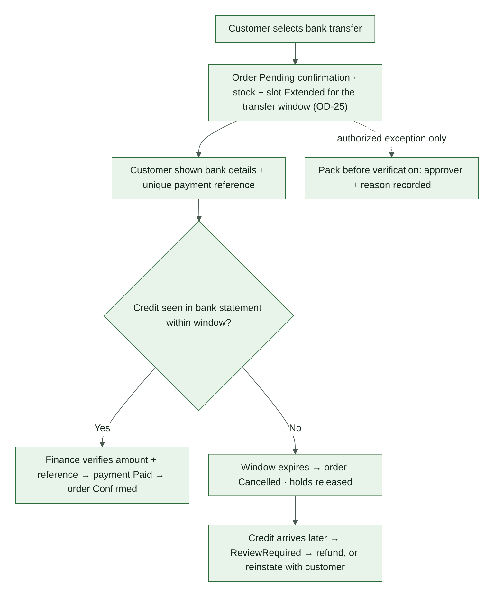
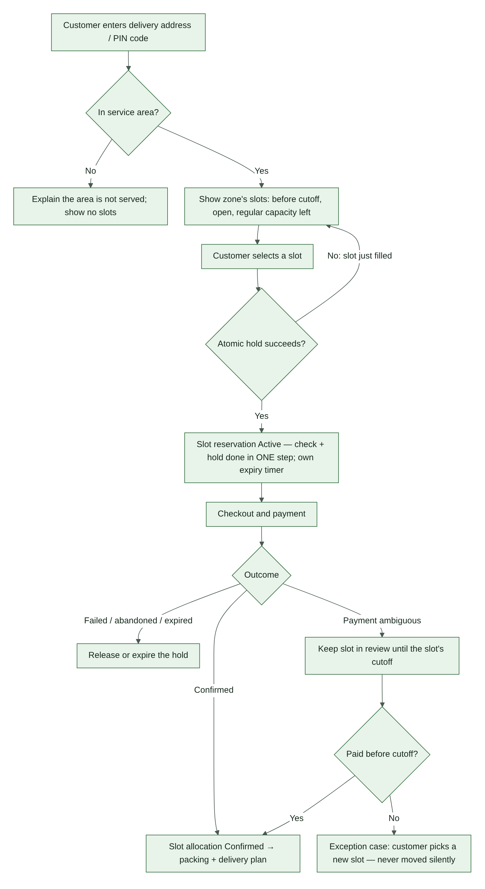
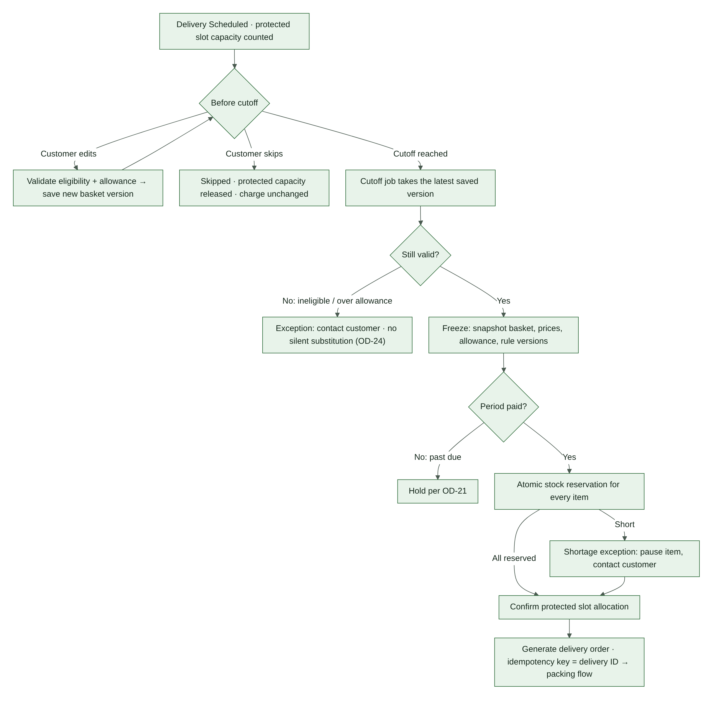
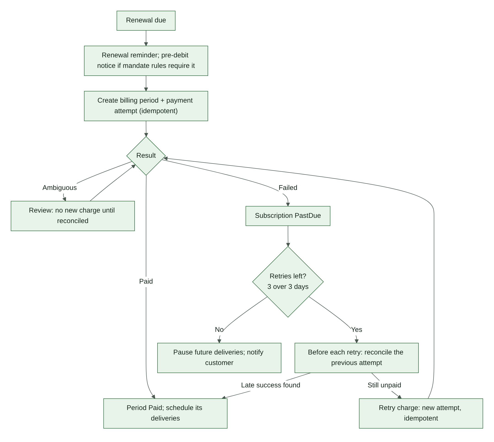
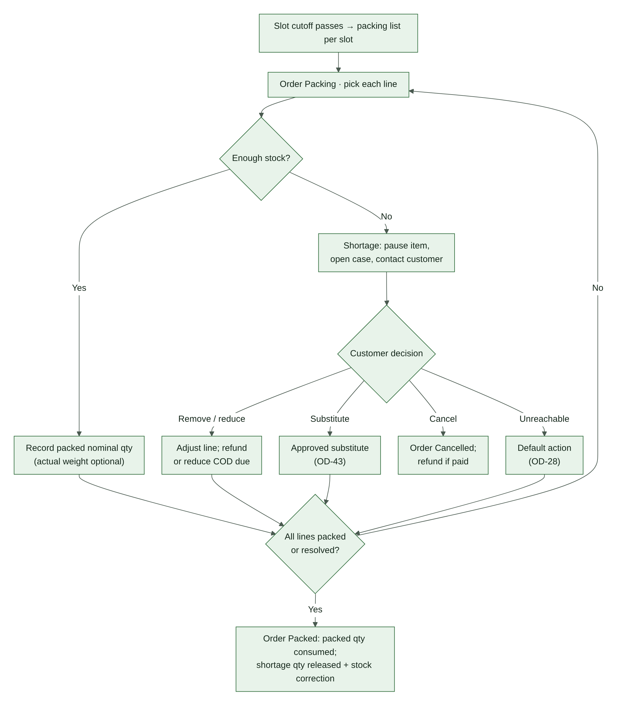
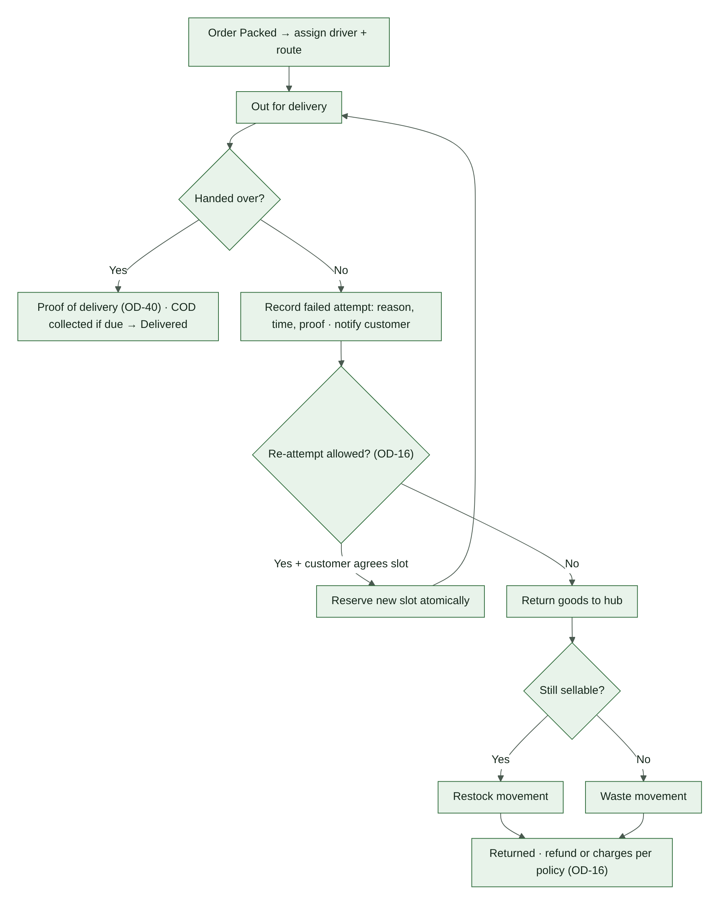

\pagebreak

# 12. Core Workflows

Each workflow names the state transitions it uses (§11). Values marked with an OD are open decisions and must stay configurable.

## 12.1 Checkout with online payment

1. Customer adds products. The server validates product, unit, quantity and channel, and prices the cart (§10).
2. Customer starts checkout. The server reprices the cart and starts the 15-minute price lock (CP-12).
3. Customer enters the delivery address. The server checks the PIN code against the service area (OD-27) and shows available slots (§12.6).
4. Customer selects a slot. The server holds slot capacity atomically (L1).
5. The server reserves stock for every line in one atomic step (R1). If any line cannot be reserved, nothing is reserved and the customer sees which line is short.
6. Customer selects a payment method. The server checks eligibility: COD rules (OD-06); bank transfer availability.
7. Customer places the order. The server checks that the price lock is valid (or that the customer has confirmed new prices — CP-13) and that the holds are active, then creates the order (O1) and one payment attempt with an idempotency key.
8. The customer is sent to the gateway for exactly the snapshot amount.
9. The gateway redirect only shows a status page; it is never proof of payment. The order is confirmed only by a verified server-to-server callback or a server status lookup (§12.2).
10. Outcomes: verified success → order Confirmed (O2); confirmed failure → holds released, and a retry creates a new attempt; no definitive result → "payment being verified" page, status lookup, and no request to pay again (O3).
11. If the online payment starts close to the reservation expiry, the reservation may be extended once (R2, OD-34).

## 12.2 Payment callback handling

1. Verify the callback signature. If it is invalid: reject it, raise a security alert, change nothing.
2. Check the idempotency record for this gateway event. If already processed: acknowledge and do nothing.
3. Lock the payment attempt record so two callbacks cannot process it at the same time.
4. Failure event → payment Failed (P5); release holds or allow a new attempt.
5. Success event → compare amount, currency and order with the snapshot. Mismatch → payment ReviewRequired (P6) and an exception case.
6. If the order or its holds are no longer valid (expired or cancelled): payment Paid; reservation ReviewRequired (R7); late-payment case (§12.5).
7. Otherwise, in one database transaction: payment Paid (P1), order Confirmed (O2), reservations Confirmed (R3, L2), idempotency record saved.
8. Queue notifications. A failed notification never rolls back the order (NA-05).
9. Acknowledge the gateway.

A reconciliation job (§7.5) also looks up every Pending or ReviewRequired attempt with the gateway, so a missed callback cannot leave an order stuck.

## 12.3 Cash on delivery (COD)

1. COD is offered only if the server-side eligibility rules pass (OD-06).
2. The COD confirmation rule runs (OD-49). On success the order is Confirmed (O2); the payment attempt stays Pending until collection.
3. At the door, the driver records the amount and method collected (cash or UPI). The payment becomes Paid (P1).
4. If a shortage reduced the order, the driver collects the reduced amount shown on the delivery screen.
5. If delivery fails or the customer refuses, nothing is collected. The payment becomes Failed (P5) and the failed-delivery workflow runs (§12.10).
6. At day end, drivers hand over cash. Finance reconciles collected against recorded amounts; any difference opens a cod_variance case.

## 12.4 Bank transfer

1. The order is created in PendingConfirmation (O1). Stock and slot holds are extended for the bank-transfer window (R2, OD-25).
2. The customer sees bank details and a unique payment reference.
3. Finance matches the credit in the bank statement by reference and amount, and records the verification. Payment Paid (P1); order Confirmed (O2).
4. If no credit arrives within the window: order Cancelled (O4); holds released.
5. If a credit arrives after cancellation: payment ReviewRequired; refund it, or reinstate the order with the customer's agreement if stock and a slot can be secured.
6. Packing before verification is allowed only as an authorized exception, with the approver and reason recorded (CP-09).

## 12.5 Late payment after reservation expiry

1. The payment is recorded as Paid; the reservation moves to ReviewRequired (R7) and a late_payment case opens. Dispatch is blocked (CP-11).
2. The system tries to re-reserve every line atomically.
3. All lines re-secured and a slot held before its cutoff → order Confirmed (O5).
4. Some lines cannot be re-secured → contact the customer. The options are partial fulfilment with a refund of the difference, a new slot, or cancellation with a full refund (O6, F1).
5. Nothing is moved, substituted or charged differently without the customer's recorded agreement.

## 12.6 Delivery slot booking

1. Check the PIN code first. Customers outside the service area see a clear message and no slots.
2. Show only slots that are open, before their cutoff (OD-04), inside the booking window (OD-58), and with regular capacity left. Regular capacity = total − protected subscription capacity.
3. When the customer selects a slot, check capacity and create the hold as **one** atomic step (L1). If the slot has just filled, refresh the list.
4. The hold has its own expiry, separate from the stock hold (DL-07).
5. Outcomes: confirmed → allocation Confirmed (L2) and included in the packing and delivery plan; failed, abandoned or expired → released (L3, L4); payment ambiguous → held until the slot's cutoff (L5). If unresolved by then, an exception case lets the customer pick a new slot. A customer is never moved silently.
6. Rescheduling before cutoff holds the new slot first, then releases the old one (L9).
7. If staff reduce a slot's capacity below what is already allocated, the overflow orders open slot_capacity cases.

**Differences from the owner-supplied slot diagram:** (1) the service-area check now comes before slots are shown, not after a slot is picked. (2) The capacity check and the hold are now one atomic step. As drawn, two customers could both see the last place free and both book it. (3) The ambiguous-payment path, rescheduling and capacity reductions were added.

## 12.7 Subscription delivery cycle

1. Each delivery of an Active subscription is Scheduled (V1), and its protected slot capacity is counted.
2. Before the cutoff the customer may edit the basket. Each save is validated for eligibility and allowance and stored as a new version. The customer may also skip the delivery (V2) — the charge is unchanged (SB-14).
3. At cutoff, a job takes the latest saved version, or the last saved basket if no edit was made (SB-10).
4. If the basket is no longer valid — ineligible item, or over the allowance at current prices — open an exception and contact the customer (OD-24, V5). Never substitute silently.
5. Freeze the basket: snapshot items, prices, allowance and rule versions (V4).
6. If the billing period is not paid, follow OD-21.
7. Reserve stock atomically for every item. A short item opens a shortage exception (pause the item, contact the customer — DL-10).
8. Confirm the protected slot allocation.
9. Generate the delivery order with idempotency key = delivery ID (V8), linked to the subscription and period. Its order value follows OD-32. The order then follows the normal packing and delivery flow.

## 12.8 Renewal and retries

1. Send the renewal reminder. If the mandate rules for the chosen gateway require a pre-debit notice, send it within the required time (verify in Phase 1, OD-11).
2. Create the billing period and payment attempt idempotently (key = period ID + attempt number).
3. Paid → schedule the period's deliveries.
4. Ambiguous → review; no new charge until reconciled.
5. Failed → subscription PastDue (S3). Retry up to three times over three days (SB-13); counting and spacing per OD-22.
6. Before each retry, reconcile the previous attempt. If a late success is found, stop retrying.
7. Retries exhausted → pause future deliveries and notify the customer (S5).

## 12.9 Packing and shortage

1. When a slot's cutoff passes, generate its packing list. The list includes order reference, delivery date and slot, product and SKU, selling unit, quantity, channel label, customer instructions and an exception indicator.
2. Order → Packing (O7). Pick each line and record the packed nominal quantity. Record actual weight if measured (IN-07). Apply the under-weight rule (OD-57).
3. A line cannot be filled → record the shortage, pause that item, open a stock_shortage case and contact the customer (DL-10).
4. Customer decision: remove or reduce the item (refund the difference, or reduce the COD amount due); an approved substitute (OD-43); or cancel the order (O10). If the customer cannot be reached before dispatch, apply the approved default action (OD-28).
5. When every line is packed or resolved → order Packed (O9). The packed quantity is consumed (R11); the shortage quantity is released and a shortage_correction movement fixes on-hand (R12, §13.4).

## 12.10 Delivery and failed delivery

1. Assign a driver and route; dispatch (O11).
2. Handover → capture proof of delivery (OD-40) and any COD collection → Delivered (O12).
3. No handover → record the reason, time and proof; notify the customer; open a delivery_failed case (O13).
4. If policy allows a re-attempt (OD-16) and the customer agrees a slot, hold the new slot atomically and dispatch again (O14).
5. Otherwise return the goods to the hub (O15). If still sellable → return_restock movement; if not → waste movement. Refunds or charges follow OD-16.

## 12.11 Cancellation

1. A customer may cancel before packing, subject to policy (CP-15). Staff may cancel with a recorded reason.
2. Release every unconsumed stock and slot hold (R12, L9).
3. If any payment is Paid, open a system refund request (F1). It is auto-approved only if OD-38 allows it.
4. Cancellation after packing is not self-service. It goes through the shortage or failed-delivery paths, or a staff decision with a reason.

## 12.12 Refund request

1. The customer requests a refund from the order page within the refund window (OD-37): items, reason and optional photo. System-initiated requests are created automatically (F1).
2. Support reviews it under the published policy (CP-14), then approves a full or partial amount or rejects it with a reason (F5, F6).
3. Approved refunds become refund transactions (F7): through the gateway for online payments; through the method chosen in OD-39 for COD and bank transfer.
4. Completed refunds update the payment state (P10, P12) and produce a credit note where applicable (OR-03). Failed refunds are retried or resolved manually (F9–F12).

## 12.13 Manual stock adjustment and stocktake

1. Staff enter product, quantity, unit, reason and actor (§13.6). Timestamp is automatic.
2. The screen shows on-hand, reserved and available separately, and warns if available would go negative.
3. Adjustments above a configured size need approval (approved_by).
4. Each adjustment writes an InventoryMovement and an AuditEvent. Balances are never overwritten.
5. A periodic stocktake compares counted with on-hand and posts stocktake_correction movements.

## 12.14 Wholesale quote (skeleton — OD-14)

1. A customer requests a quote for quantities or terms outside the published tiers.
2. Staff with quote permission set prices per line, a validity date and a reason; approval is recorded.
3. The customer accepts within the validity period; the quote converts into an order at the quoted prices, recorded as an override with actor, reason, amount, approval and expiry (§8.4).
4. Expired quotes cannot be converted.

## 12.15 Customer reports a debit after a failed-looking payment (CP-16)

1. Support opens a reported_debit case. The customer is not asked to pay again yet.
2. Finance looks up the attempt with the gateway and checks settlement records (P9).
3. Money received → payment Paid. Then: order confirmed if stock and slot can be secured, or refunded if not.
4. Money not received → share the result of the check with the customer, pass on the gateway's guidance on how and when an unsettled debit is reversed, then offer a new attempt.
